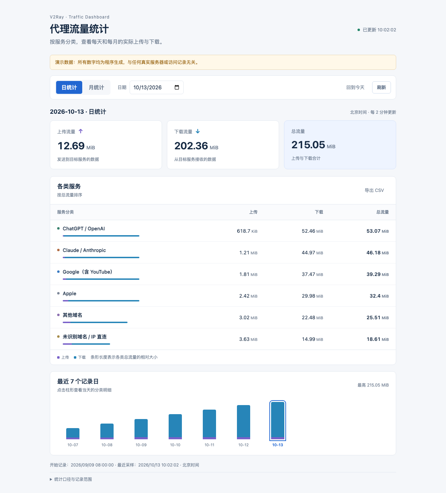

# v2ray-traffic-dashboard

轻量、自托管的 **V2Ray 分类流量统计面板**。按服务分类记录每天、每月的上传、下载和总流量，用静态网页展示；支持手机布局、每日趋势和 CSV 导出。

**English:** A lightweight, self-hosted V2Ray category traffic dashboard. Cumulative outbound counters are sampled into SQLite, exported as static JSON, and displayed in a responsive web UI. No runtime Python packages, frontend build step or always-on application server.



## 功能与边界

- 统计采集每两分钟运行一次，空闲时没有常驻 Python 进程。
- SQLite 保存日汇总，默认保留 400 个自然日；网页按北京时间汇总日/月数据。
- 预设 OpenAI、Claude、Google（含 YouTube）、Apple、其他域名和未识别域名/IP 直连，可修改分类配置。
- 不清零 V2Ray 计数器；首次采样只建立基线，不把已有累积流量误算为当日流量。
- 记录计数器重置和采样间隔事件，页面显示数据延迟或边界遗漏提示。
- 网页只读静态汇总，不包含代理控制、配置编辑或原始访问日志。
- 安装程序不运行包管理器，不修改现有 Nginx 主配置，也不改写/启动/重启 V2Ray。

这是**按目标服务归类的代理出站字节统计**，不是每个网页 URL、浏览器标签页、设备或应用的精确计费。第三方资源会进入其实际目标域名所属分类；示例域名列表不完整，需要按需维护。DNS/SNI 不可识别时会进入其他或未识别分类。只有选定的 `freedom` 出站覆盖的连接会被分类，其他出站保持原行为且不计入此面板。

## 前提与兼容性

| 用途 | 要求 |
|---|---|
| 模拟演示、导出与测试 | Python 3.9+，仅标准库；macOS/Linux 可运行 |
| 实际采集 | Linux、systemd、V2Ray 的 StatsService 和出站计数器 |
| 网页托管 | 操作系统独立安装的 Nginx、`htpasswd` 工具；公网访问须 HTTPS |
| 已验证的原型运行环境 | Amazon Linux 2023、V2Ray 5.22.0、Nginx 静态托管 |
| 通用安装器 | 独立暂存根中测试安装与卸载；不能视为所有发行版安装均已实测 |

首版针对 V2Ray 支持的传统 JSON 配置格式。Xray、Docker 部署、非 systemd 系统和负载均衡配置未作为支持目标。多文件配置见[接入说明](docs/v2ray-integration.md)。

## 先体验模拟演示

```sh
git clone https://github.com/yaoyuyang8599-cpu/v2ray-traffic-dashboard.git
cd v2ray-traffic-dashboard
python3 scripts/demo.py --output /tmp/vtd-demo --serve
```

打开 `http://127.0.0.1:8765`。所有流量都是程序生成，页面会显示“演示数据”。演示只监听本机、不连接 V2Ray；不能把演示 HTTP 服务用于公开真实统计。输出目录必须不存在，可换一个新的目录；按 Ctrl+C 结束服务。

## 安装

### 1. 确认依赖并预览

在服务器上独立准备 Python 3.9+、Nginx、logrotate 和 `htpasswd`，先核对系统包升级对现有服务的影响。仓库不下载或捆绑这些程序。

```sh
python3 --version
command -v nginx
command -v htpasswd
python3 scripts/install.py
```

不带 `--apply` 只显示安装路径；也可用离线暂存根检查所有生成文件：

```sh
python3 scripts/install.py --destdir /tmp/vtd-install-preview
```

### 2. 安装独立文件

```sh
sudo python3 scripts/install.py --apply --nginx-binary /usr/sbin/nginx --web-user nobody
```

`--nginx-binary` 必须填写本机实际路径，`--web-user` 必须是本机存在的低权限账户。可使用 `www-data` 或 `nginx`。正式安装自动使用该用户的实际主组（例如 Ubuntu 的 `nobody:nogroup`），也可通过 `--web-group` 指定；跨系统离线暂存时应显式填写目标系统组名。程序拒绝覆盖已有应用目录、配置目录、网页目录、日志目录或同名 unit；路径必须互不包含。保留已有统计数据目录，不替换数据库。

默认位置：

| 内容 | 路径 |
|---|---|
| 代码和 CLI | `/opt/v2ray-traffic-dashboard` |
| 配置和密码文件 | `/etc/v2ray-traffic-dashboard` |
| SQLite 私有统计数据 | `/var/lib/v2ray-traffic-dashboard` |
| 网页和静态汇总 | `/var/www/v2ray-traffic-dashboard` |
| 网页日志 | `/var/log/v2ray-traffic-dashboard` |
| 独立 systemd unit | `v2ray-traffic-dashboard.service/.timer`、`v2ray-traffic-dashboard-web.service` |

支持 `--prefix`、`--state-dir`、`--web-dir`、`--config-dir`、`--unit-dir`、`--log-dir`、`--port`。自定义路径后，下列命令中的默认路径也要对应修改。安装完成时服务尚未启动，网页默认仅监听 `127.0.0.1:8080`，且必须有密码文件。

### 3. 配置统计来源

编辑 `/etc/v2ray-traffic-dashboard/config.json`：

- `v2ray_binary`：实际 V2Ray 可执行文件的绝对路径。
- `v2ray_service`：V2Ray 的 systemd 服务名。
- `stats_server`：只允许 loopback API，例如 `127.0.0.1:10085`。
- `categories`：分类 ID、展示名、出站 tag 和域名匹配规则；最后一项必须是空域名的兜底分类。
- `retention_days`：保留天数，1–3650，默认 400。

如果 V2Ray 还没有分类出站统计，按[分类接入、备份和回滚说明](docs/v2ray-integration.md)生成候选配置，验证并人工启用。**首次启用分类需要计划一次 V2Ray 重启；本项目不会自动执行这一步。** 已有匹配分类出站时只需对齐 tag。

### 4. 检查并启动采集

```sh
sudo /opt/v2ray-traffic-dashboard/bin/v2ray-traffic-dashboard doctor
sudo systemctl enable --now v2ray-traffic-dashboard.timer
sudo systemctl start v2ray-traffic-dashboard.service
sudo systemctl status v2ray-traffic-dashboard.service
sudo /opt/v2ray-traffic-dashboard/bin/v2ray-traffic-dashboard report --period today
```

首次采样只建立基线，第二次采样后出现日统计。没有分类计数器时 doctor/采集会明确失败；不要通过添加 `--reset` 或清空数据库来“修复”。

### 5. 设置登录和 HTTPS

```sh
sudo htpasswd -c /etc/v2ray-traffic-dashboard/htpasswd stats
sudo chmod 640 /etc/v2ray-traffic-dashboard/htpasswd
sudo chgrp "$(stat -c '%g' /etc/v2ray-traffic-dashboard)" /etc/v2ray-traffic-dashboard/htpasswd
```

交互式设置自己的强密码。`-c` 会创建/覆盖密码文件，已有账户时去掉 `-c`。不要在命令行参数、Git、日志或截图中写明文密码。

先按[HTTPS 与访问保护说明](docs/https.md)设置证书、公网入口和续期；HTML、脚本和所有 `/data/*.json` 都必须保留认证。随后验证并启动独立网页服务：

```sh
sudo /usr/sbin/nginx -t -c /etc/v2ray-traffic-dashboard/nginx.conf
sudo systemctl enable --now v2ray-traffic-dashboard-web.service
```

它使用自己的 Nginx 配置和 PID，不会 reload 系统现有 Nginx。若共用 80/443，请使用已有 HTTPS 入口反代本机 8080，不争用端口。浏览器会弹出标准 HTTP Basic 登录框；不要关闭认证后公开访问。

## 查看、排错与备份

```sh
sudo /opt/v2ray-traffic-dashboard/bin/v2ray-traffic-dashboard report --period month --json
sudo /opt/v2ray-traffic-dashboard/bin/v2ray-traffic-dashboard report --period 2026-01
sudo systemctl list-timers v2ray-traffic-dashboard.timer
sudo journalctl -u v2ray-traffic-dashboard.service -n 30 --no-pager
```

页面超过 5 分钟未采样会提示延迟。检查 binary/service/API/tag、unit 错误及目录权限；不需要为网页故障重启 V2Ray。Nginx 日志按 daily/maxsize 5MiB、保留 3 份压缩轮转；定时 logrotate 由系统负责。

备份前只停止本项目的采集 timer，并等待正在运行的 oneshot 结束，再复制 SQLite 和私有配置；备份完重新启用 timer。不要停代理。完整命令及恢复步骤见[维护说明](docs/maintenance.md)。

## 卸载

```sh
sudo python3 scripts/uninstall.py --apply
```

只停止/删除本项目 unit、代码、网页、配置（包括 htpasswd）和网页日志；**保留统计数据目录，不修改或重启 V2Ray**。已启用的分类路由继续存在，若也要撤销，需按接入文档使用原始备份另行回滚代理。程序会拒绝不安全路径和符号链接，不提供自动清空统计数据选项。

## 测试

```sh
PYTHONPATH=src python3 -m unittest discover -s tests -v
python3 -m compileall -q src scripts
```

测试覆盖累积计数、基线、重启/单向重置、跨午夜、保留天数、只读导出、隐私字段排除、候选配置保留原路由、配置校验、离线安装/卸载和符号链接拒绝。

可选浏览器测试（Node.js 18+，仅开发依赖；实际网页不依赖 Playwright）：

```sh
npm install --no-save --package-lock=false playwright
npx playwright install chromium
node tests/browser.cjs
```

自动生成临时模拟数据并测试日/月汇总、空月份、CSV、趋势点击、刷新、手机布局及控制台错误。GitHub Actions 执行 Python 和浏览器测试，不连接任何真实代理服务器。

## 统计精度

- 仅记录启用后采样增量，无法补算历史流量。
- 计数器重置后记录新进程已产生的字节；旧进程最后一次采样至退出间的尾部字节可能遗漏。
- 跨午夜的增量计入采样结束所在日；不是按每个数据包的精确发生时间分日。
- 采样间隔事件按采样日记录，边界损失提示是审计信息，不能恢复缺失字节。
- 计数为 V2Ray 出站应用字节，不等于云服务商计费流量或网卡总流量；TLS、协议开销与其他系统服务可能产生差异。
- 静态文件分别原子替换，月份文件先发布、索引后发布；极短时间内多文件请求可能跨越一次采样，刷新会读取最新汇总。

## 许可证

本项目源码采用 [MIT](LICENSE)。第三方程序不包含在源码仓库内，仍按各自许可证分发，见 [THIRD_PARTY_NOTICES.md](THIRD_PARTY_NOTICES.md)。项目不收集遥测，不提供任何公共真实统计演示账户。
